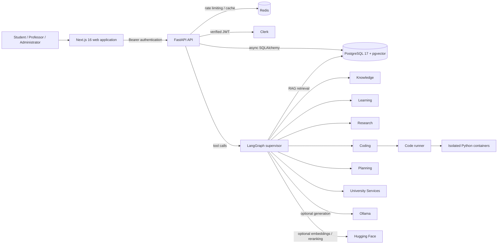

# UniMind AI

**An intelligent university operations and learning platform combining retrieval-augmented generation, multi-agent workflows, academic tooling, role-based access control, and isolated code execution.**

[](https://github.com/MahdiLcoder/unimind-ai/actions/workflows/ci-cd.yml)
[](https://nextjs.org/)
[](https://fastapi.tiangolo.com/)
[](https://www.python.org/)
[](https://www.postgresql.org/)
[](https://www.docker.com/)

> UniMind AI is a full-stack academic product prototype built for students, professors, and administrators. It demonstrates practical integration of modern web development, LLM orchestration, vector retrieval, authentication, data security, DevOps, and reproducible evaluation.

## Table of contents

- [Overview](#overview)
- [Key capabilities](#key-capabilities)
- [System architecture](#system-architecture)
- [Technology stack](#technology-stack)
- [Repository structure](#repository-structure)
- [Quick start](#quick-start)
- [Local development](#local-development)
- [Authentication and authorization](#authentication-and-authorization)
- [AI and RAG architecture](#ai-and-rag-architecture)
- [Testing and quality](#testing-and-quality)
- [Deployment](#deployment)
- [Security considerations](#security-considerations)
- [Project status](#project-status)
- [Documentation](#documentation)
- [Contributing](#contributing)

## Overview

UniMind AI provides a unified workspace for academic activities:

- Students can query course documents, manage assignments and study plans, complete quizzes, run coding exercises, and search academic literature.
- Professors can organize course workspaces, assign learning activities, publish quizzes, and review course-level learning activity.
- Administrators can manage users and roles, govern workspaces and feature flags, and review audit records.

The implementation combines a Next.js application with a FastAPI backend, PostgreSQL with pgvector, Redis, Clerk authentication, LangGraph agent workflows, optional Ollama and Hugging Face inference, and a separate sandboxed code runner.

## Key capabilities

### Intelligent academic workspace

- Document upload and parsing for PDF, Word, and PowerPoint inputs
- Chunking and semantic indexing with pgvector
- Private, course-scoped document retrieval
- Cited, streamed answers and source metadata
- Persistent conversation and checkpoint state

### Multi-agent AI platform

The supervisor routes requests across seven specialist agents:

- Knowledge
- Learning
- Research
- Coding
- Planning
- University Services
- A supervisor/coordinator for dependency-aware orchestration

The graph supports routing, parallel execution, bounded retries, insufficient-evidence retries, and persisted execution events.

### Academic and learning tools

- Course workspaces and student enrollment
- Assignments, quizzes, attempts, and study plans
- AI-assisted lessons and flashcard-oriented learning flows
- Crossref literature search, saved bibliography, summaries, and comparisons
- Coding generation, review, debugging, tutoring, and challenge feedback
- Dashboard summaries and persistent in-app notifications

### Governance and platform services

- Server-side Clerk identity resolution
- Student, professor, and administrator roles
- Administrator-only role and feature management
- API health, readiness, metrics, audit, and rate-limit controls
- Docker, Docker Compose, Kubernetes, monitoring, and rollback workflows

## System architecture



### Request lifecycle

1. The browser authenticates through Clerk.
2. Next.js sends an API request with a Clerk bearer token.
3. FastAPI verifies the token, issuer, audience/party, expiration, and JWKS configuration.
4. The API resolves or provisions a server-side local user and role.
5. Route authorization derives course and document permissions from database relationships.
6. The agent or service executes the requested operation and persists relevant state.
7. Streaming responses send events and a final cited answer to the browser.

## Technology stack

| Area | Technologies |
|---|---|
| Frontend | Next.js 16, React 19, TypeScript, Tailwind CSS 4, shadcn/ui, TanStack Query, Recharts |
| Backend | Python 3.11+, FastAPI, Pydantic Settings, async SQLAlchemy, Alembic |
| AI orchestration | LangGraph, LangChain core integrations, custom routing and agent workflows |
| Retrieval | pgvector, PDF/Word/PowerPoint parsing, embeddings, reranking |
| Authentication | Clerk JWT verification and role-aware API authorization |
| Data and caching | PostgreSQL 17, Redis 8 |
| Model providers | Ollama; optional Hugging Face sentence-transformer and reranker models |
| Code execution | Docker-backed, network-disabled Python runner with resource limits |
| Testing | Vitest, Testing Library, Playwright, pytest, Ruff |
| Operations | Docker Compose, GitHub Actions, GHCR, Kubernetes/Kustomize, Prometheus, Grafana |

## Repository structure

```text
apps/web/                 Next.js application and browser tests
services/ai-api/          FastAPI service, migrations, API tests, scripts
ai/                       Reusable agents, graphs, RAG, models, prompts, state
infrastructure/           Docker, Kubernetes, monitoring, and recovery tooling
docs/                     Architecture, API, deployment, evaluation, and user guides
docker-compose.yml        Local development stack
docker-compose.production.yml
                          Production-oriented Compose deployment
pnpm-workspace.yaml       JavaScript workspace configuration
```

## Quick start

### Prerequisites

- Docker Engine and Docker Compose v2
- Node.js 22+
- pnpm 10+
- Python 3.11+
- `uv`

### Start the complete local stack

```bash
cp .env.example .env
docker compose up --build
```

Default endpoints:

| Service | URL |
|---|---|
| Web application | http://localhost:3000 |
| FastAPI documentation | http://localhost:8000/docs |
| API liveness probe | http://localhost:8000/health/live |
| API readiness probe | http://localhost:8000/health/ready |

Stop the stack while preserving named database and cache volumes:

```bash
docker compose down
```

Postgres and Redis are available locally on ports `5432` and `6379` by default. Override host ports with `POSTGRES_HOST_PORT`, `REDIS_HOST_PORT`, and `WEB_HOST_PORT` in `.env`.

### Optional local inference

The default Compose startup does not download model weights:

```bash
docker compose --profile inference up --build
```

This starts Ollama and pulls `qwen2.5:3b` by default. For local Hugging Face embeddings and reranking, set:

```dotenv
INSTALL_HF_INFERENCE=true
HF_RERANKER_ENABLED=true
```

Then rebuild the API image. Model caches and Ollama data are stored in named Docker volumes.

## Local development

Install dependencies and start the Next.js workspace:

```bash
cp .env.example .env
pnpm install
pnpm dev
```

Start data services:

```bash
docker compose up -d postgres redis
```

Run the API in a separate terminal:

```bash
cd services/ai-api
uv sync
uv run alembic upgrade head
uv run uvicorn app.main:app --reload --host 0.0.0.0 --port 8000
```

Set `NEXT_PUBLIC_API_URL` to an API origin reachable from the browser. The API and Next.js both load the repository root `.env`; never commit real credentials or use local example passwords outside development.

## Authentication and authorization

Clerk manages frontend sessions and password recovery. The FastAPI service verifies bearer tokens against configured JWKS and issuer values and resolves a local user record.

Required Clerk settings include:

- `NEXT_PUBLIC_CLERK_PUBLISHABLE_KEY`
- `CLERK_SECRET_KEY`
- `CLERK_JWKS_URL`
- `CLERK_ISSUER`
- `CLERK_AUTHORIZED_PARTIES`

New users receive the `student` role. Initial administrators can be configured through `ADMIN_CLERK_USER_IDS`. Subsequent role changes and privileged operations are restricted to server-side administrator authorization.

The API does not trust browser-supplied roles or course scopes. Document and course permissions are derived from ownership, enrollment, professor assignments, or administrator status.

## AI and RAG architecture

The retrieval implementation is kept in `ai/rag` and model/provider abstractions in `ai/models`, allowing the API and evaluation tools to share common interfaces.

Key retrieval behaviors include:

- Multi-format document parsing
- Chunking and vector generation
- pgvector persistence
- Optional reranking
- Document ownership and course-level access filtering
- Cited response metadata
- Prompt isolation and retrieval-context defense-in-depth

The agent workflow is implemented with LangGraph. Routing selects one or more specialists, execution events are recorded, and checkpoints and conversation state are persisted for continuity.

### Optional benchmark

The repository includes a paired direct-RAG/supervisor evaluator that records retrieval metrics, route matches, citation validity, latency, and optional Ragas measurements.

No approved 50–100 question university corpus or manually reviewed paired benchmark results are currently included. Generated placeholders must not be presented as measured answer quality or factual accuracy. See [Testing, evaluation, and security](docs/testing-evaluation-security.md) before reporting results.

## Testing and quality

Run the frontend quality suite:

```bash
pnpm install --frozen-lockfile
pnpm check
```

This runs frontend linting, type checking, and Vitest tests. Run browser tests separately:

```bash
PLAYWRIGHT_CHANNEL=chrome \
PLAYWRIGHT_TEST_BASE_URL=http://localhost:3000 \
pnpm --filter web test:e2e
```

Run backend static checks and tests:

```bash
cd services/ai-api
uv sync --frozen
uv run ruff check . ../../ai
uv run pytest -q
```

The CI workflow also validates:

- Locked pnpm dependencies
- Frontend lint, types, tests, and build
- Python formatting and lint rules
- Backend tests
- Alembic upgrades against PostgreSQL with pgvector
- Docker image builds

Coverage includes authentication and role checks, document ownership and course scoping, upload validation, agent routing and retries, checkpoint state, API errors, and rate limiting.

## Deployment

Supported deployment patterns include:

- Local Docker Compose
- Production-oriented Docker Compose with immutable GHCR images
- Kubernetes using Kustomize overlays
- GitHub Actions CI/CD and image publishing
- Manual application rollback
- Prometheus and Grafana monitoring

The production Compose and Kubernetes configurations require externally provisioned secrets and infrastructure. PostgreSQL and Redis StatefulSets are single-instance configurations; managed services or separately designed high availability are recommended for production availability requirements.

See [Deployment and operations](docs/deployment.md) for infrastructure prerequisites, secret handling, image publishing, Kubernetes, monitoring, and rollback procedures.

## Security considerations

- Clerk JWT signature, issuer, expiration, and authorized-party checks
- Server-side role resolution and protected route authorization
- Database-derived ownership and course access controls
- Redis-backed fixed-window API rate limiting
- Redis failure handling that fails closed rather than silently disabling protection
- Restricted document upload parsing and file validation
- Prompt-context isolation and injection phrase detection as defense in depth
- Network-disabled code execution containers with CPU, memory, process, timeout, and output limits

The Docker-socket-backed code runner is effectively host-root authority. It is not a production-ready untrusted execution boundary. Run production workloads with dedicated, preferably rootless, isolated infrastructure rather than exposing a host Docker socket.

Additional hardening and operational requirements are documented in [Testing, evaluation, and security](docs/testing-evaluation-security.md).

## Project status

The repository contains a functional local/full-stack prototype and reproducible infrastructure configurations. The following items should be communicated accurately:

- Human-approved academic benchmark questions and paired answer-quality results are not yet included.
- Professor and administrator flows require more complete end-to-end verification.
- The optional code runner has been tested locally, but production isolation remains an infrastructure gap.
- PostgreSQL/Redis integration and real-model checks require reachable services and model weights.
- Push notifications, automated human approval interrupts, and high-availability data stores are not included.

These boundaries are intentionally documented rather than represented as completed production guarantees.

## Documentation

### Architecture and APIs

- [Architecture overview](docs/architecture/overview.md)
- [RAG architecture](docs/architecture/rag.md)
- [Architecture diagrams](docs/architecture/diagrams.md)
- [API overview](docs/api/README.md)
- [Learning and planning API](docs/api/learning.md)
- [Research API](docs/api/research.md)
- [User profile API](docs/api/users.md)

### Operations and quality

- [Deployment and operations](docs/deployment.md)
- [Testing, evaluation, and security](docs/testing-evaluation-security.md)
- [Technical report](docs/report/technical-report.md)
- [Experimental evaluation report](docs/evaluation/experimental-evaluation-report.md)

### User guides

- [Installation guide](docs/user/installation-guide.md)
- [Developer guide](docs/user/developer-guide.md)
- [Student guide](docs/user/student-guide.md)
- [Professor guide](docs/user/professor-guide.md)
- [Administrator guide](docs/user/administrator-guide.md)
- [Troubleshooting guide](docs/user/troubleshooting-guide.md)

## Contributing

1. Create an integration branch from `develop`.
2. Use focused branch names: `feat/<topic>`, `fix/<topic>`, `docs/<topic>`, or `chore/<topic>`.
3. Keep changes scoped and add focused tests for behavior changes.
4. Run `pnpm check` and the backend Ruff/pytest commands before submitting.
5. Use Conventional Commit messages, for example `feat(api): add readiness checks`.
6. Do not commit secrets, local environment files, model caches, databases, or generated test artifacts.

For code-specific setup, inspect the service and workspace documentation and keep changes consistent with the existing module boundaries.
