# Architecture diagrams

All diagrams use Mermaid so they remain reviewable and version-controlled.

## 1. Global system architecture

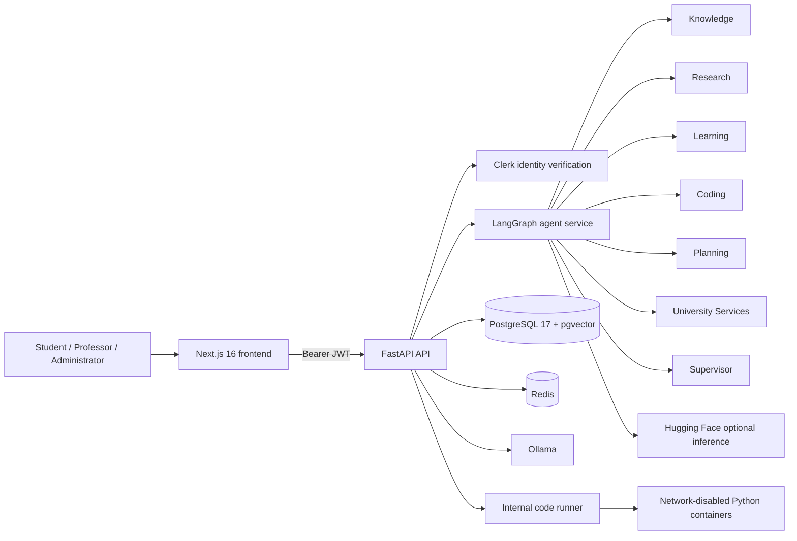

## 2. Frontend/backend communication

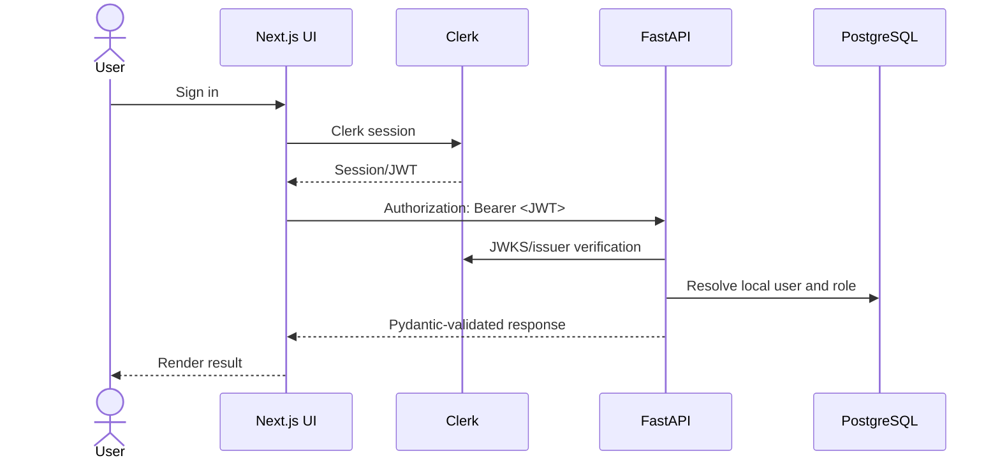

## 3. Database ERD

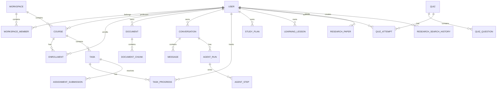

## 4. RAG ingestion pipeline

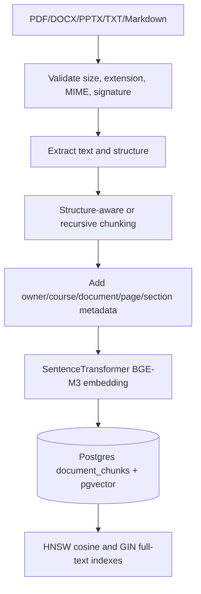

## 5. RAG retrieval pipeline

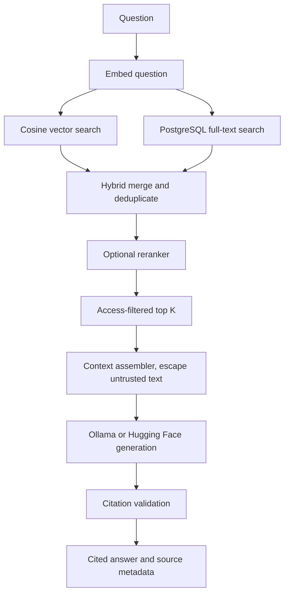

## 6. Multi-agent architecture

```mermaid
flowchart TD
    REQ[Authenticated agent request] --> SUP[Supervisor]
    SUP --> RT[Intent and routing matrix]
    RT --> KB[Knowledge]
    RT --> RS[Research]
    RT --> LN[Learning]
    RT --> CD[Coding]
    RT --> PL[Planning]
    RT --> US[University Services]
    KB --> EV[Evaluate evidence]
    RS --> EV
    LN --> EV
    CD --> EV
    PL --> EV
    US --> EV
    EV --> RET{Failed or insufficient?}
    RET -->|One retry|max| AG[Retry eligible agents]
    RET -->|No| FIN[Combine response]
    AG --> EV
    FIN --> SSE[SSE timeline or JSON response]
```

## 7. Supervisor workflow

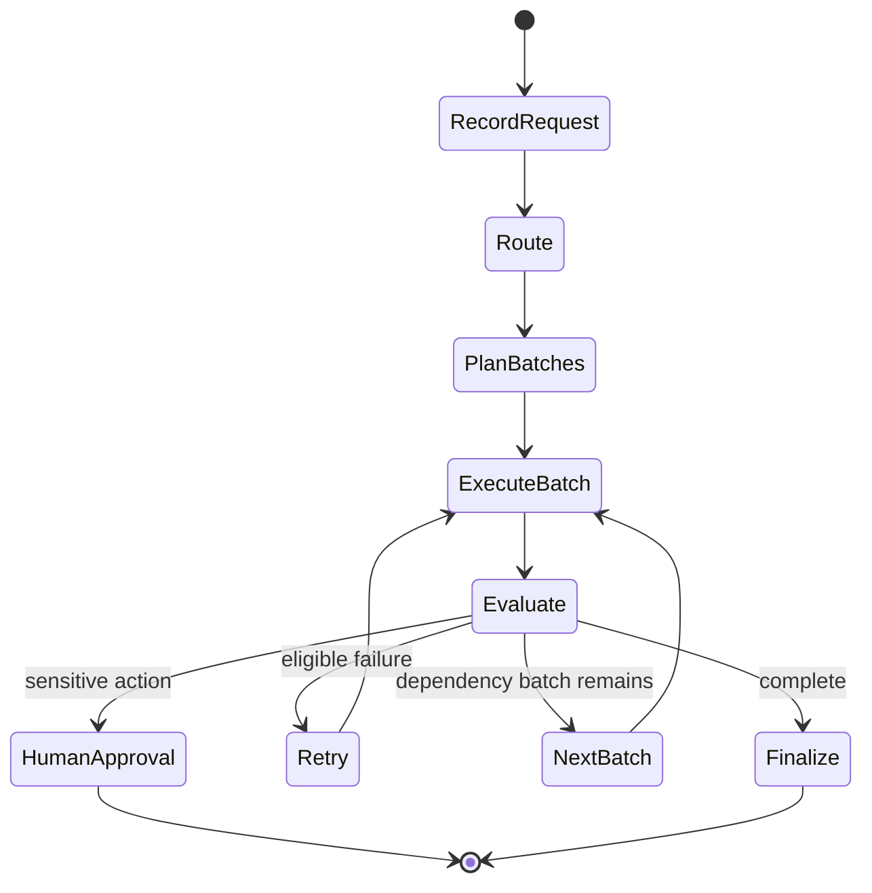

## 8. Sequence diagrams

### Course question

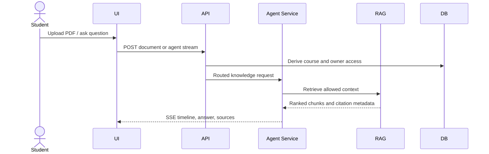

### Quiz and study plan

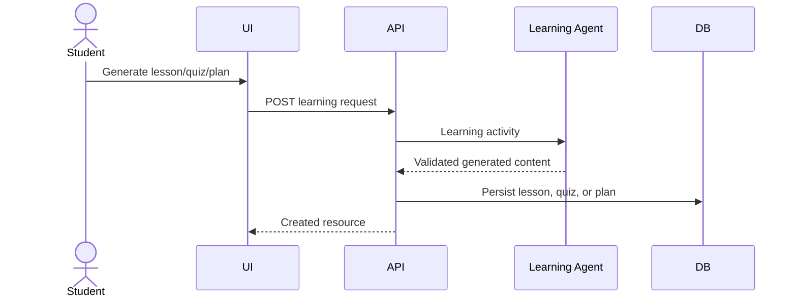

### Coding execution

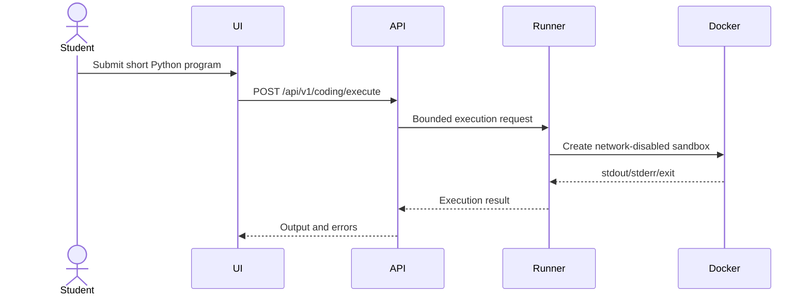

## 9. Deployment architecture

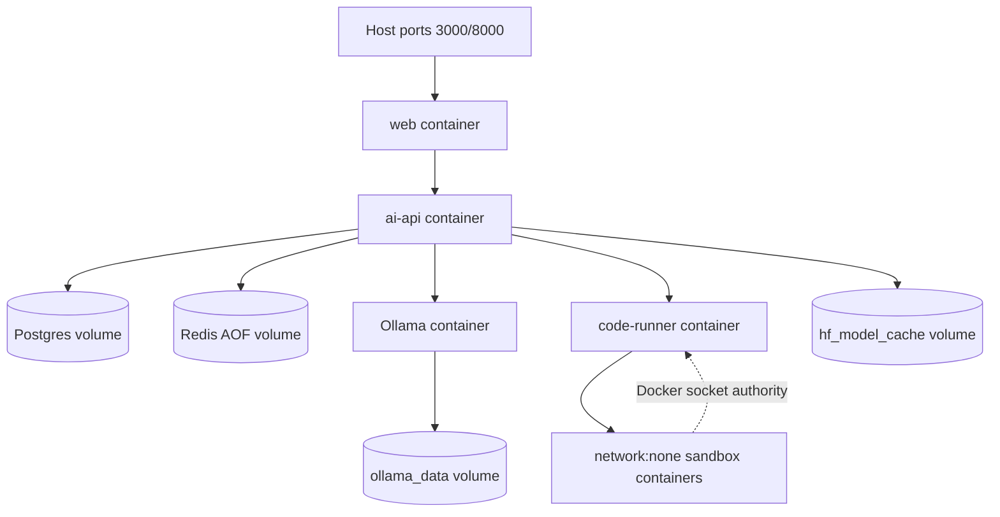

## 10. CI/CD pipeline

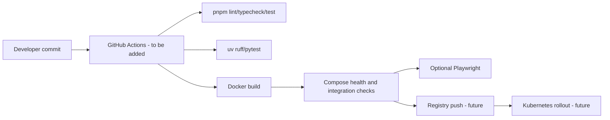

Status: the diagram shows the target pipeline. The repository currently has no
verified `.github/workflows` CI manifest or live registry/deployment step.
