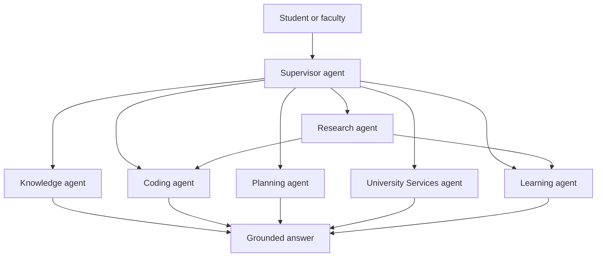

# Foundation architecture

```text
Browser ──HTTP──> Next.js (apps/web) ──HTTP/CORS──> FastAPI (services/ai-api)
                                                      ├── async SQLAlchemy ──> PostgreSQL 17 + pgvector
                                                      └── redis-py ──────────> Redis (AOF persistence)
                                                       └── internal HTTP ────> Code runner ──> isolated Python containers
```

Docker Compose at the repository root runs PostgreSQL, Redis, FastAPI, an
internal code runner, and Next.js. The Python sandbox image is built by a
one-shot service. The API starts after database, cache, and runner health checks
pass, applies Alembic migrations, and then serves requests. PostgreSQL data and
Redis append-only files use named volumes.

## API health

- `GET /health/live` is a liveness probe and does not depend on external
  services.
- `GET /health` remains available for compatibility with the original API
  health endpoint.
- `GET /health/ready` runs `SELECT 1` and a Redis `PING`. It returns `200` with
  per-dependency status when both checks pass, otherwise `503`.
- `GET /api/v1/test` is a small integration endpoint used by the frontend
  connection page.

The API reads database, Redis, and CORS settings from environment variables.
The checked-in `.env.example` contains local-only defaults; actual `.env` files
are ignored by Git. Add schema changes as Alembic revisions under
`services/ai-api/migrations/versions`.

The reusable RAG pipeline lives in `ai/rag` and model providers in `ai/models`.
It uses the API's async SQLAlchemy models and pgvector persistence. See
[RAG architecture](rag.md) for module interfaces, migration, access boundaries,
and optional inference setup.

The agent layer now includes a supervisor graph, Knowledge and Learning agents,
plus Research, Coding, Planning, and University Services specialists. Task
routing selects a single agent or a dependency-aware batch; the graph supports
parallel fan-out, retry on insufficient evidence, and event recording for each
agent execution. The conversation and checkpoint state persist user session
history, while the optional learning-memory store keeps user preferences and
progress isolated by user ID.



Clerk provides the frontend session and password-recovery flows. FastAPI
validates Clerk bearer tokens against the configured issuer and JWKS, checks the
authorized party, and resolves a server-side user role. New users default to
student; administrator role assignment is restricted to administrators, with
initial administrators configured through `ADMIN_CLERK_USER_IDS`. RAG routes
must use the resolved principal and enrolled course memberships for permission
filters; browser-provided owner IDs, roles, and course scopes are not trusted.

Private document upload, listing, deletion, and semantic search are exposed
through `/api/v1/documents`; each request uses the verified Clerk user as owner.
The `/api/v1/agents/stream` workflow can retrieve these documents and streams
execution events, a cited final response, and source metadata. Course-scoped
documents use database-derived course permissions: active enrollment for
students, ownership for professors, and administrator access. The University
Services agent only answers questions from configured verified official
sources and fails closed when no trustworthy source is available.

The application also exposes course and enrollment management, course
assignments, quizzes and attempts, task and study-plan APIs, Crossref research
search and saved papers, and role-protected user administration. Professors
can create course assignments and quizzes and inspect course-level learning
activity. Python execution uses a dedicated internal runner that creates
short-lived containers with no network, a read-only root filesystem, a
non-root identity, and CPU, memory, process, time, and output limits. The
runner's Docker Engine socket is host-root authority; deployments handling
untrusted submissions should use a dedicated, preferably rootless Docker
host, and must not expose the runner service. The dashboard derives task,
course, quiz, deadline, and agent-run summaries, with persistent in-app
notifications for course assignments and published quizzes. Administrators
can manage workspaces, allowlisted feature flags, and audit records. Push
notifications and a comprehensive learning-analytics suite are not
implemented.
