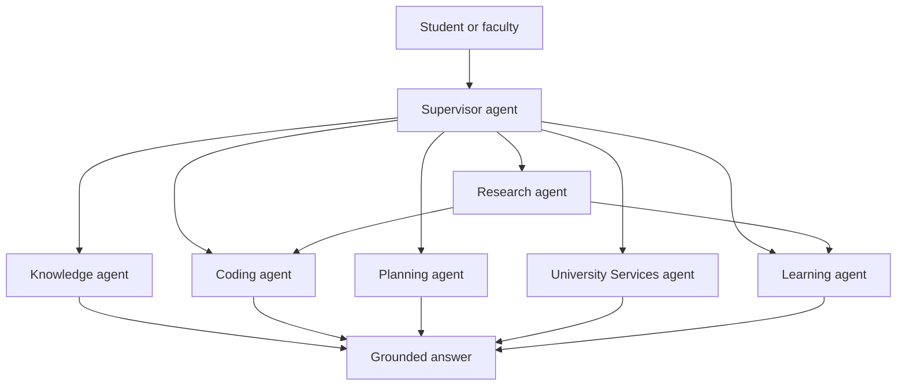

# Foundation architecture

```text
Browser ──HTTP──> Next.js (apps/web) ──HTTP/CORS──> FastAPI (services/ai-api)
                                                      ├── async SQLAlchemy ──> PostgreSQL 17 + pgvector
                                                      └── redis-py ──────────> Redis (AOF persistence)
```

Docker Compose at the repository root runs all four services. The API starts
after database and cache health checks pass, applies Alembic migrations, and
then serves requests. PostgreSQL data and Redis append-only files use named
volumes.

## API health

- `GET /health/live` is a liveness probe and does not depend on external
  services.
- `GET /health` remains available for compatibility with the original API
  health endpoint.
- `GET /health/ready` runs `SELECT 1` and a Redis `PING`. It returns `200` with
  per-dependency status when both checks pass, otherwise `503`.
- `GET /api/v1/test` is a small integration endpoint used by the frontend
  connection page.

The API reads database, Redis, and CORS settings from environment variables.
The checked-in `.env.example` contains local-only defaults; actual `.env` files
are ignored by Git. Add schema changes as Alembic revisions under
`services/ai-api/migrations/versions`.

The reusable RAG pipeline lives in `ai/rag` and model providers in `ai/models`.
It uses the API's async SQLAlchemy models and pgvector persistence. See
[RAG architecture](rag.md) for module interfaces, migration, access boundaries,
and optional inference setup.

The agent layer now includes a supervisor graph, Knowledge and Learning agents,
plus Research, Coding, Planning, and University Services specialists. Task
routing selects a single agent or a dependency-aware batch; the graph supports
parallel fan-out, retry on insufficient evidence, and event recording for each
agent execution. The conversation and checkpoint state persist user session
history, while the optional learning-memory store keeps user preferences and
progress isolated by user ID.



HTTP upload and query endpoints remain deferred until a trusted identity
provider can supply the owner and course memberships used by the RAG permission
filters. The University Services agent only answers questions from configured
verified official sources and fails closed when no trustworthy source is
available.
